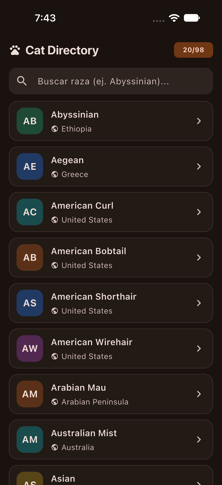
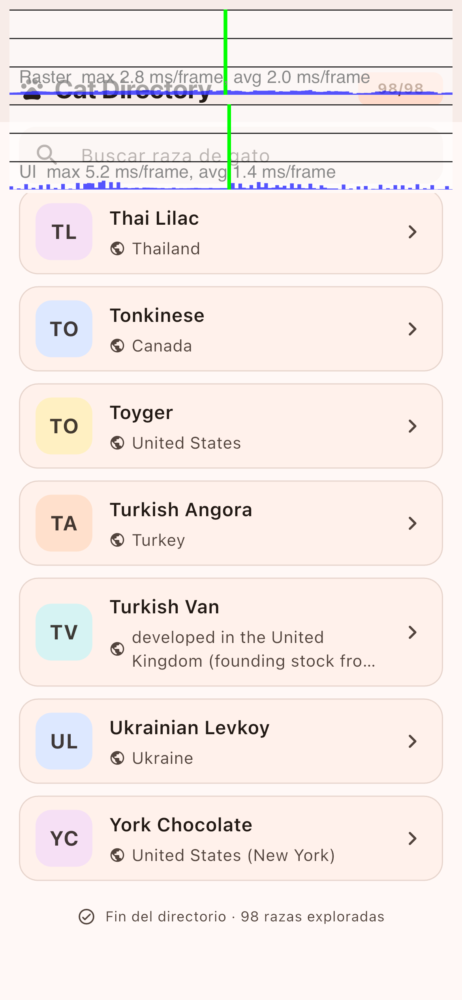

# Cat Directory App (`cat-directory-app`)

Directorio interactivo de razas de gatos desarrollado en **Flutter 3.50.1 (Dart 3.14)** consumiendo la API pública de [Catfact Ninja](https://catfact.ninja/), como solución a la Prueba Técnica de **Nextep Innovation (Mobile Developer)**.

Diseñada con enfoque **Offline-First (Stale-While-Revalidate)**, resiliencia ante redes intermitentes, control estricto de concurrencia, accesibilidad verificada y rendimiento sostenido a **60 FPS sin jank**.

---

## Capturas de Pantalla

| Directorio (Light Mode) | Directorio (Dark Mode) | Detalle + Dato Curioso (Light) | Detalle + Dato Curioso (Dark) |
| :---: | :---: | :---: | :---: |
|  |  |  |  |

---

## Funcionalidades Implementadas

### Requerimientos Obligatorios
- **Directorio de razas (`GET /breeds`)**: Listado fluido con `CustomScrollView` + `SliverList.separated` y tarjetas aisladas con `RepaintBoundary` mostrando nombre (`breed`) y país de origen (`country`).
- **Paginación Infinite Scroll con control de concurrencia**: Carga automática al aproximarse al final de la lista (20 razas por página) protegida con `droppable()` para impedir múltiples requests simultáneos.
- **Pull to Refresh**: Invalidación explícita de caché local y recarga desde la página 1 (si está offline, conserva la lista y el caché mostrando un aviso amigable).
- **Búsqueda local con debounce**: Filtrado en memoria por nombre de raza con `debounce(300ms)` sin mutar ni perder la lista cargada, e indicando al usuario si puede cargar más páginas para ampliar el universo en memoria.
- **Ruteo parametrizado con `GoRouter`**: Pantalla de detalle accesible en `/breed/:name` (con encoding seguro de caracteres/espacios y soporte para resolución en frío cuando `extra` es `null`).
- **Offline-First (Stale-While-Revalidate) + Caché con TTL explícito**: Persistencia de la página 1 en `SharedPreferences` envuelta en un `CacheEnvelope<T>` con `cachedAt`, **TTL de 10 minutos**, verificación `isExpired()` e invalidación explícita. Al abrir sin conexión, la lista cacheada se renderiza instantáneamente sin pantalla vacía ni error bloqueante.
- **Vista de Detalle + 2do Endpoint (`GET /fact`)**: Muestra los 5 atributos completos (`Breed`, `Country`, `Origin`, `Coat`, `Pattern`) y un **Dato Curioso Aleatorio** con estado de carga (`FactSkeleton`), manejo de error y botón de recarga totalmente independientes.
- **Resiliencia de red y UX ante fallos**:
  - Monitoreo proactivo/reactivo de red (`connectivity_plus`): *fast-fail* offline (evita desperdiciar reintentos esperando timeouts) y **auto-revalidación automática** al recuperar conexión.
  - **Backoff exponencial con jitter** en `Dio` (`ExponentialBackoffInterceptor`): hasta **3 reintentos** (`500ms`, `1000ms`, `2000ms` + jitter `0–200ms`) para timeouts, errores de conexión, `429` y `5xx`.
  - Si falla una página intermedia del infinite scroll, **las razas ya cargadas se conservan intactas** y se ofrece un botón inline *"Reintentar página"*.
- **Accesibilidad (`Semantics`)**: Labels semánticos, hints, encabezados (`header: true`), `ExcludeSemantics` en elementos decorativos y `liveRegion: true` en carga/errores/datos curiosos, validados con pruebas automatizadas de guías Android e iOS.
- **Auditoría de Performance y Tamaño del APK**: Documentada abajo con captura real, traza de Flutter DevTools y salida de `flutter build apk --release --analyze-size`.

### Funcionalidades Opcionales (PLUS)
- **Deep Linking nativo real**: Configurados **Android App Links** (`autoVerify="true"` + `assetlinks.json`), **iOS Universal Links** (`Runner.entitlements` + `apple-app-site-association`) y custom scheme `catdirectory://breed/:name`.
- **Dark Mode**: Temas Material 3 claro/oscuro responsivos automáticamente a la configuración del sistema (`ThemeMode.system`).
- **Animaciones**: Transiciones `Hero` fluidas del monograma entre la tarjeta del directorio y la cabecera del detalle.
- **Manejo de ciclo de vida Foreground/Background**: `WidgetsBindingObserver` revalida el caché automáticamente cuando la app regresa a primer plano tras superar el TTL o ≥ 5 minutos en segundo plano.
- **Testing Unitario + Accesibilidad + Integración**: 17 tests automatizados (`bloc_test`, `mocktail`, `flutter_test`) cubriendo BLoC, backoff exponencial, TTL/caché, ruteo y accesibilidad.
- **APK Release precompilado**: Disponible en la sección de [Releases](https://github.com/DanielRojas-hub/cat-directory-app/releases) del repositorio.

---

## Arquitectura y Gestor de Estados

### Feature-Driven Clean Architecture
El proyecto separa infraestructura compartida (`lib/core/`) de las funcionalidades de negocio (`lib/features/breeds/`), aplicando dentro de cada feature las tres capas de Clean Architecture (`domain`, `data`, `presentation`):

```text
lib/
├── main.dart
├── app.dart                         # MaterialApp.router, ThemeMode.system, WidgetsBindingObserver
├── core/
│   ├── di/injection.dart            # Contenedor get_it
│   ├── errors/app_failure.dart      # Sealed class AppFailure + mapeo DioException
│   ├── network/                     # DioClientFactory, ExponentialBackoffInterceptor, ConnectivityMonitor
│   ├── router/app_router.dart       # GoRouter (/ y /breed/:name + 404)
│   ├── storage/cache_envelope.dart  # CacheStore + CacheEnvelope con TTL e invalidación
│   └── theme/app_theme.dart         # Material 3 Light & Dark themes
└── features/breeds/
    ├── domain/                      # Entidades Freezed (Breed, BreedsPage, CatFact) y contrato BreedsRepository
    ├── data/                        # DTOs json_serializable, Remote/Local DataSources y BreedsRepositoryImpl (SWR)
    └── presentation/                # BreedsBloc, BreedDetailCubit, Pages y Widgets reutilizables
```

**¿Por qué Feature-Driven Clean Architecture?**  
Para un MVP de cuidado de mascotas con proyección de crecimiento (futuros módulos de perfil, vacunas, favoritos), agrupar primero por feature maximiza la cohesión y permite escalar en equipo sin mezclar archivos entre módulos, manteniendo la regla de dependencia de Clean Architecture (la UI solo conoce estados/eventos y el dominio es independiente de Dio o `SharedPreferences`).

### ¿Por qué BLoC (`flutter_bloc` + `bloc_concurrency`)?
- **Transformadores de eventos de primera clase**: `droppable()` garantiza control estricto de concurrencia en `BreedsNextPageRequested` y `BreedsRefreshed`, mientras `debounce(300ms)` (`stream_transform`) controla la búsqueda local de forma declarativa y sin timers manuales propensos a fugas.
- **Trazabilidad y testabilidad**: Cada transición (`SWR cache → revalidating → fresh`, `offline → online recovery`, `intermediate page failure`) es un estado inmutable generado con `freezed`, 100% verificable con `bloc_test`.
- **Separación de ciclos de vida**: `BreedDetailCubit` gestiona de forma desacoplada la resolución de la raza (incluido el lookup paginado para Deep Links en frío) y el estado independiente del endpoint `/fact`.

---

## Cómo Ejecutar el Proyecto

### Prerrequisitos
- **Flutter**: `3.50.1` (canal `stable`) · **Dart**: `3.14.0`
- Xcode (para simulador/dispositivo iOS) y/o Android SDK 35+ (para Android / compilación de APK)

### Pasos
```bash
# 1. Clonar el repositorio
git clone https://github.com/DanielRojas-hub/cat-directory-app.git
cd cat-directory-app

# 2. Instalar dependencias
flutter pub get

# 3. (Opcional) Regenerar archivos Freezed / json_serializable
dart run build_runner build

# 4. Ejecutar la aplicación
flutter run

# 5. Ejecutar con PerformanceOverlay visible (auditoría visual)
flutter run --profile --dart-define=SHOW_PERF_OVERLAY=true
```

### Ejecutar Tests y Análisis Estático
```bash
flutter analyze
flutter test
```

### Probar Deep Linking Nativo (`/breed/:name`)
Los archivos de verificación de dominio están incluidos en [`.well-known/assetlinks.json`](.well-known/assetlinks.json) (Android App Links) y [`.well-known/apple-app-site-association`](.well-known/apple-app-site-association) (iOS Universal Links).

```bash
# Android (App Link o custom scheme)
adb shell am start -a android.intent.action.VIEW \
  -d "https://cat-directory.nextep.dev/breed/Abyssinian" \
  com.nextep.catdirectory.cat_directory_app

adb shell am start -a android.intent.action.VIEW \
  -d "catdirectory://breed/Abyssinian" \
  com.nextep.catdirectory.cat_directory_app

# iOS Simulator
xcrun simctl openurl booted "catdirectory://breed/Abyssinian"
```

---

## Auditoría de Performance (Obligatorio)

### 1. Evidencia de Scroll sin Jank (`98/98` razas cargadas)

Se ejecutó un benchmark reproducible de scroll infinito ([`integration_test/scroll_performance_test.dart`](integration_test/scroll_performance_test.dart)) recorriendo todas las páginas de la API (5 páginas, **98 razas completas**) seguido de flings rápidos sostenidos arriba y abajo con el directorio entero en memoria:

```bash
flutter drive \
  --driver=test_driver/perf_driver.dart \
  --target=integration_test/scroll_performance_test.dart \
  --dart-define=SHOW_PERF_OVERLAY=true
```

<p align="center">
  
</p>

**Métricas registradas en [`docs/performance/scroll_performance.timeline_summary.json`](docs/performance/scroll_performance.timeline_summary.json):**

| Métrica (Budget 60 FPS = `16.67 ms`) | Resultado | Estado |
| :--- | :---: | :---: |
| `average_frame_build_time_millis` (UI) | **`1.70 ms`** | Óptimo (9.8× bajo el límite) |
| `90th_percentile_frame_build_time_millis` (UI) | **`2.89 ms`** | Sin jank |
| `99th_percentile_frame_build_time_millis` (UI) | **`8.64 ms`** | Sin jank |
| `worst_frame_build_time_millis` (UI) | **`13.29 ms`** | Bajo `16.67 ms` |
| `missed_frame_build_budget_count` | **`0`** | 0 frames perdidos |
| `average_frame_rasterizer_time_millis` (Raster) | **`0.83 ms`** | Óptimo |
| `worst_frame_rasterizer_time_millis` (Raster) | **`1.77 ms`** | Óptimo |
| `missed_frame_rasterizer_budget_count` | **`0`** | 0 frames perdidos |
| `60hz_frame_percentage` / `old_gen_gc_count` | **`100.0%` / `0`** | Sin pausas de GC |

**Análisis de frames y decisiones que mantienen 0 jank:**
- En la captura del `PerformanceOverlay` (ejecutada en simulador iOS) aparece un único pico puntual en el hilo UI (`max 31.9 ms`) al inicio del búfer del overlay, correspondiente a la compilación JIT del primer frame/transición en modo simulador. Durante el scroll sostenido medido en el `TimelineSummary` (**72 frames**, 98/98 razas cargadas), **0 frames excedieron el presupuesto de `16.67 ms`** (`worst UI: 13.29 ms`, `avg UI: 1.70 ms`, `avg Raster: 0.83 ms`).
- Factores clave de rendimiento: `SliverList.separated` con lazy rendering, tarjetas aisladas con `RepaintBoundary`, avatares determinísticos sin decodificación de bitmaps de red, `buildWhen` selectivos en `BlocBuilder`, y skeleton loader custom ligero.

---

### 2. Análisis de Tamaño del APK (`--analyze-size`)

Comando ejecutado:
```bash
flutter build apk --release --analyze-size --target-platform android-arm64
```

Resumen completo en [`docs/performance/apk_size_analysis.txt`](docs/performance/apk_size_analysis.txt):

```text
Font asset "CupertinoIcons.ttf" was tree-shaken: 257,628 B -> 848 B (99.7% reduction)
Font asset "MaterialIcons-Regular.otf" was tree-shaken: 1,645,184 B -> 5,380 B (99.7% reduction)
✓ Built build/app/outputs/flutter-apk/app-release.apk (18.4 MB)

app-release.apk (total compressed)                                         18 MB
├── lib/arm64-v8a                                                          16 MB
│   └── Dart AOT symbols (decompressed: 5 MB)
│       ├── package:flutter                                                 2 MB
│       ├── package:material_ui                                           631 KB
│       ├── dart:core / ui / typed_data / async / io / convert           ~1.1 MB
│       ├── package:cat_directory_app (código propio)                     111 KB
│       ├── package:go_router                                              70 KB
│       └── package:dio                                                    46 KB
├── classes.dex                                                           392 KB
├── lib/x86_64 + armeabi-v7a (shims nativos de plugins AndroidX)          208 KB
├── assets/flutter_assets                                                 132 KB
└── res/ + resources.arsc + AndroidManifest.xml + META-INF                133 KB
```

**Explicación del tamaño:**
- **Base fija del runtime (`16 MB` en `lib/arm64-v8a`)**: ~87% del APK comprimido corresponde al motor de Flutter (Impeller/Skia + Dart VM AOT), costo base inherente a toda app Flutter compilada para `arm64-v8a`.
- **Código de la aplicación y dependencias mínimas**: Todo el código propio (`package:cat_directory_app`) ocupa solo **`111 KB`** descomprimido; `go_router` (`70 KB`) y `dio` (`46 KB`) mantienen una huella mínima. Al evitar librerías pesadas de shimmer, imágenes o animaciones Lottie, `flutter_assets` se mantiene en **`132 KB`**.
- **Tree-shaking de fuentes**: Flutter redujo en **99.7%** tanto `MaterialIcons-Regular.otf` (`1.65 MB → 5.38 KB`) como `CupertinoIcons.ttf` (`257 KB → 848 B`).
- **Shims `armeabi-v7a` (`86 KB`) y `x86_64` (`122 KB`)**: Bibliotecas nativas ligeras empaquetadas por dependencias AndroidX (`androidx.datastore` / `shared_preferences_android`). En producción con distribución por Google Play (`.aab`), Play Delivery elimina automáticamente cualquier ABI que no corresponda al dispositivo.

---

## Accesibilidad (`Semantics`)

- **Buscador**: `Semantics(textField: true, label: 'Buscar raza de gato', hint: 'Filtra por nombre entre las razas cargadas')`.
- **Lista de razas**: Cada tarjeta consolida su lectura mediante `Semantics(button: true, label: 'Raza X, país de origen Y', hint: 'Toca dos veces para ver detalles y un dato curioso', excludeSemantics: true)` excluyendo el monograma decorativo.
- **Estados dinámicos**: Los skeletons de carga, el banner offline/SWR, el footer de error de paginación y las actualizaciones de `CatFactCard` usan `liveRegion: true` para anunciarse automáticamente en **VoiceOver** y **TalkBack**.
- **Validación**: Verificado mediante [`test/accessibility_test.dart`](test/accessibility_test.dart) cumpliendo `androidTapTargetGuideline`, `iOSTapTargetGuideline` y `labeledTapTargetGuideline`, además de recorrido manual en iOS Simulator.

---

## Autor

**Daniel Rojas** — Prueba Técnica Mobile Developer (Nextep Innovation).
