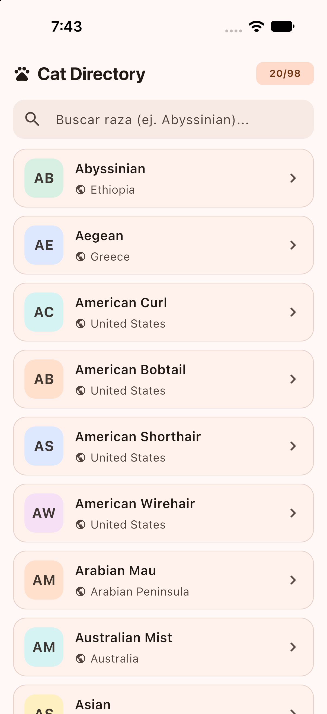
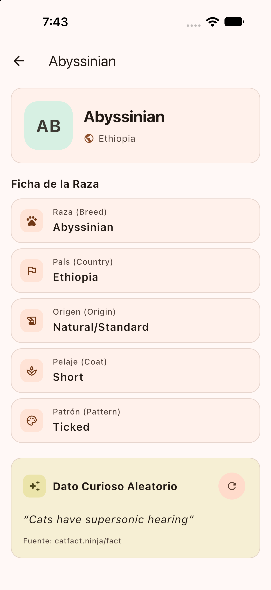
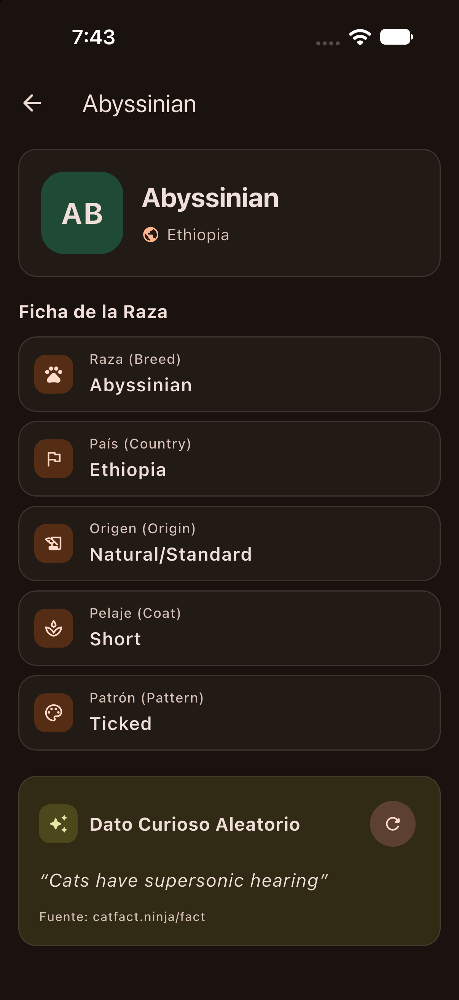

# Cat Directory App (`cat-directory-app`)

Directorio interactivo de razas de gatos desarrollado en **Flutter 3.50.1 (Dart 3.14)** consumiendo la API pública de [Catfact Ninja](https://catfact.ninja/), como solución a la Prueba Técnica de **Nextep Innovation (Mobile Developer)**.

Diseñada con enfoque **Offline-First (Stale-While-Revalidate)**, resiliencia ante redes intermitentes, control estricto de concurrencia, accesibilidad verificada y rendimiento sostenido a **60 FPS sin jank**.

> [!IMPORTANT]
> **Prerrequisitos de SDK (Obligatorio):** este proyecto requiere **Flutter `3.50.1` (`stable`)** y **Dart `3.14.0`** (`environment: sdk: ^3.14.0`), ya que utiliza el paquete modular `material_ui: ^1.11.1` introducido en Flutter 3.50. Verifica tu entorno con `flutter --version` antes de ejecutar `flutter pub get`.

---

## Capturas de Pantalla

| Directorio (Light Mode) | Directorio (Dark Mode) | Detalle + Dato Curioso (Light) | Detalle + Dato Curioso (Dark) |
| :---: | :---: | :---: | :---: |
|  |  |  |  |

---

## Funcionalidades Implementadas

### Requerimientos Obligatorios
- **Directorio de razas (`GET /breeds`)**: Listado fluido con `CustomScrollView` + `SliverList.separated` y tarjetas aisladas con `RepaintBoundary` mostrando nombre (`breed`) y país de origen (`country`).
- **Paginación Infinite Scroll con control de concurrencia**: Carga automática al aproximarse al final de la lista (20 razas por página) protegida con `droppable()` para impedir múltiples requests simultáneos.
- **Pull to Refresh**: Recarga desde la página 1 con sobrescritura atómica del caché local solo tras respuesta exitosa (preserva intacto el respaldo offline-first si falla la red o no hay conexión, sincronizado con `RefreshIndicator` vía `Completer<void>`).
- **Búsqueda local con debounce**: Filtrado en memoria por nombre de raza con `debounce(300ms)` al escribir y limpieza instantánea al pulsar `X` (`immediate: true`), sin mutar ni perder la lista cargada, con `keyboardDismissBehavior.onDrag`, sincronía de controlador y botón para cargar más páginas.
- **Ruteo parametrizado con `GoRouter`**: Pantalla de detalle accesible en `/breed/:name` (con encoding seguro de caracteres/espacios y soporte para resolución en frío cuando `extra` es `null`).
- **Offline-First (Stale-While-Revalidate) + Caché con TTL explícito**: Persistencia de la página 1 en `SharedPreferences` envuelta en un `CacheEnvelope<T>` con `cachedAt`, **TTL de 10 minutos**, verificación `isExpired()` e invalidación explícita. Al abrir sin conexión, la lista cacheada se renderiza instantáneamente sin pantalla vacía ni error bloqueante.
- **Vista de Detalle + 2do Endpoint (`GET /fact`)**: Muestra los 5 atributos completos (`Breed`, `Country`, `Origin`, `Coat`, `Pattern`) y un **Dato Curioso Aleatorio** con estado de carga (`FactSkeleton`), manejo de error y botón de recarga totalmente independientes.
- **Resiliencia de red y UX ante fallos**:
  - Monitoreo proactivo/reactivo de red (`connectivity_plus`): *fast-fail* offline (evita desperdiciar reintentos esperando timeouts) y **auto-revalidación automática** al recuperar conexión.
  - **Backoff exponencial con jitter** en `Dio` (`ExponentialBackoffInterceptor`): hasta **3 reintentos** (`500ms`, `1000ms`, `2000ms` + jitter `0–200ms`) para timeouts, errores de conexión, `429` y `5xx`.
  - Si falla una página intermedia del infinite scroll, **las razas ya cargadas se conservan intactas** y se ofrece un botón inline *"Reintentar página"*.
- **Accesibilidad (`Semantics`)**: Labels semánticos, hints, encabezados (`header: true`), `ExcludeSemantics` en elementos decorativos y `liveRegion: true` en carga/errores/datos curiosos, validados con pruebas automatizadas de guías Android/iOS y revisión del árbol de `Semantics`.
- **Auditoría de Performance y Tamaño del APK**: Documentada abajo con captura real, traza de Flutter DevTools (`613` frames continuos), compilación de APK universal multi-ABI y desglose `flutter build apk --release --analyze-size`.

### Funcionalidades Opcionales (PLUS)
- **Deep Linking nativo**: Custom scheme `catdirectory://breed/:name` funcional de inmediato en local, más configuración nativa de **Android App Links** (`autoVerify="true"`) e **iOS Universal Links** (`Runner.entitlements`) acompañados de plantillas [`.well-known/assetlinks.json`](.well-known/assetlinks.json) y [`.well-known/apple-app-site-association`](.well-known/apple-app-site-association) listas para desplegar en un dominio productivo HTTPS.
- **Dark Mode**: Temas Material 3 claro/oscuro responsivos automáticamente a la configuración del sistema (`ThemeMode.system`).
- **Animaciones**: Transiciones `Hero` fluidas del monograma entre la tarjeta del directorio y la cabecera del detalle.
- **Manejo de ciclo de vida Foreground/Background**: `WidgetsBindingObserver` revalida el caché automáticamente cuando la app regresa a primer plano tras superar el TTL o ≥ 5 minutos en segundo plano.
- **Testing Unitario + Accesibilidad + Regresión UI/QA + Integración**: **95 tests automatizados** (`bloc_test`, `mocktail`, `flutter_test`) cubriendo BLoC/concurrencia/TTL, backoff exponencial (`IOException`/5xx), conectividad, mapeo `AppFailure`, ruteo/deep links, accesibilidad (`SemanticsAction.tap`), stress responsivo (`320px`, Landscape, `textScaler` `1.5x–2.0x`), paginación de 98 razas y temas Light/Dark, más prueba de integración de scroll sostenido (`integration_test/scroll_performance_test.dart`).
- **APK Release precompilado**: Disponible en la sección de [Releases](https://github.com/DanielRojas-hub/cat-directory-app/releases) del repositorio (APK universal multi-ABI y `arm64-v8a`).

---

## Arquitectura y Gestor de Estados

### Feature-Driven Clean Architecture
El proyecto separa infraestructura compartida (`lib/core/`) de las funcionalidades de negocio (`lib/features/breeds/`), aplicando dentro de cada feature las tres capas de Clean Architecture (`domain`, `data`, `presentation`):

```text
lib/
├── main.dart
├── app.dart                         # MaterialApp.router, ThemeMode.system, WidgetsBindingObserver
├── core/
│   ├── di/injection.dart            # Contenedor get_it
│   ├── errors/app_failure.dart      # Sealed class AppFailure + mapeo DioException
│   ├── network/                     # DioClientFactory, ExponentialBackoffInterceptor, ConnectivityMonitor
│   ├── router/app_router.dart       # GoRouter (/ y /breed/:name + 404)
│   ├── storage/cache_envelope.dart  # CacheStore + CacheEnvelope con TTL e invalidación
│   └── theme/app_theme.dart         # Material 3 Light & Dark themes
└── features/breeds/
    ├── domain/                      # Entidades Freezed (Breed, BreedsPage, CatFact) y contrato BreedsRepository
    ├── data/                        # DTOs json_serializable, Remote/Local DataSources y BreedsRepositoryImpl (SWR)
    └── presentation/                # BreedsBloc, BreedDetailCubit, Pages y Widgets reutilizables
```

**¿Por qué Feature-Driven Clean Architecture?**  
Para un MVP de cuidado de mascotas con proyección de crecimiento (futuros módulos de perfil, vacunas, favoritos), agrupar primero por feature maximiza la cohesión y permite escalar en equipo sin mezclar archivos entre módulos, manteniendo la regla de dependencia de Clean Architecture (la UI solo conoce estados/eventos y el dominio es independiente de Dio o `SharedPreferences`).

### ¿Por qué BLoC (`flutter_bloc` + `bloc_concurrency`)?
- **Transformadores de eventos y control de concurrencia de primera clase**: `droppable()` evita duplicados en `BreedsStarted`, `BreedsNextPageRequested` y `BreedsAppResumed`, complementado con época de generación (`_requestEpoch`) y `Completer<void>` en `BreedsRefreshed` para impedir condiciones de carrera entre SWR, refresh y paginación; `debounce(300ms)` con bypass inmediato (`immediate: true`) controla la búsqueda local sin lag al limpiar.
- **Trazabilidad y testabilidad**: Cada transición (`SWR cache → revalidating → fresh`, `offline → online recovery`, `intermediate page failure`) es un estado inmutable generado con `freezed`, 100% verificable con `bloc_test`.
- **Separación de ciclos de vida**: `BreedDetailCubit` gestiona de forma desacoplada la resolución de la raza (incluido el lookup paginado para Deep Links en frío) y el estado independiente del endpoint `/fact`.

---

## Cómo Ejecutar el Proyecto

### Prerrequisitos
- **Flutter**: `3.50.1` (canal `stable`) · **Dart**: `3.14.0` (requerido por `sdk: ^3.14.0` y `material_ui: ^1.11.1`)
- Xcode (para simulador/dispositivo iOS) y/o Android SDK 35+ (para Android / compilación de APK)

### Pasos
```bash
# 1. Clonar el repositorio
git clone https://github.com/DanielRojas-hub/cat-directory-app.git
cd cat-directory-app

# 2. Verificar versión de SDK e instalar dependencias
flutter --version
flutter pub get

# 3. (Opcional) Regenerar archivos Freezed / json_serializable
dart run build_runner build

# 4. Ejecutar la aplicación
flutter run

# 5. Ejecutar con PerformanceOverlay visible en modo Profile (dispositivo físico o emulador Android)
flutter run --profile --dart-define=SHOW_PERF_OVERLAY=true
```

### Ejecutar Tests y Análisis Estático
```bash
flutter analyze
flutter test
```

### Probar Deep Linking Nativo (`/breed/:name`)

> [!NOTE]
> **Alcance de `.well-known`:** el custom scheme `catdirectory://breed/:name` y la ruta parametrizada `/breed/:name` funcionan de inmediato en pruebas locales. Los archivos [`.well-known/assetlinks.json`](.well-known/assetlinks.json) y [`.well-known/apple-app-site-association`](.well-known/apple-app-site-association) son **plantillas listas para desplegar** en un dominio HTTPS productivo: para activar la verificación automática del sistema operativo (Android App Links / iOS Universal Links) se debe sustituir `REPLACE_WITH_RELEASE_KEYSTORE_SHA256_FINGERPRINT` por el SHA-256 del keystore de release, reemplazar `TEAM_ID` por el Apple Developer Team ID y alojar ambos archivos en `https://cat-directory.nextep.dev/.well-known/`.

```bash
# Android (custom scheme funcional en local; HTTPS requiere desplegar assetlinks.json en dominio productivo)
adb shell am start -a android.intent.action.VIEW \
  -d "catdirectory://breed/Abyssinian" \
  com.nextep.catdirectory.cat_directory_app

adb shell am start -a android.intent.action.VIEW \
  -d "https://cat-directory.nextep.dev/breed/Abyssinian" \
  com.nextep.catdirectory.cat_directory_app

# iOS Simulator (custom scheme funcional en local)
xcrun simctl openurl booted "catdirectory://breed/Abyssinian"
```

---

## Auditoría de Performance (Obligatorio)

### 1. Evidencia de Scroll sin Jank (`98/98` razas cargadas · `613` frames continuos)

Se implementó un benchmark reproducible de scroll infinito ([`integration_test/scroll_performance_test.dart`](integration_test/scroll_performance_test.dart)) que primero carga las 5 páginas completas de la API (**98/98 razas**) y luego ejecuta barridos bidireccionales sostenidos a cadencia de 60 Hz (`timedDrag` + `fling` con bombeo cada `16 ms`) dentro de `binding.traceAction`:

```bash
# Comando oficial en modo --profile (dispositivo físico Android/iOS o emulador Android):
flutter drive \
  --profile \
  --endless-trace-buffer \
  --driver=test_driver/perf_driver.dart \
  --target=integration_test/scroll_performance_test.dart \
  --dart-define=SHOW_PERF_OVERLAY=true
```

> [!NOTE]
> **Transparencia sobre el modo de ejecución:** Flutter/Xcode restringe la compilación AOT `--profile` a dispositivos físicos iOS o dispositivos/emuladores Android (`release/profile builds are only supported for physical devices`). En el entorno de entrega actual (macOS + iOS Simulator `iPhone 18 Pro`, sin AVD Android ni `DEVELOPMENT_TEAM` de firma física en el repositorio), la evidencia versionada abajo fue ejecutada sobre **iOS Simulator en modo Debug/JIT con `--endless-trace-buffer`** (omitiendo `--profile`). Dado que Debug/JIT introduce mayor sobrecarga que AOT `--profile`, mantener `0` frames perdidos en **613 frames continuos** constituye una cota conservadora favorable frente a hardware real en `--profile`.

<p align="center">
  
</p>

**Métricas registradas en [`docs/performance/scroll_performance.timeline_summary.json`](docs/performance/scroll_performance.timeline_summary.json):**

| Métrica (Budget 60 FPS = `16.67 ms`) | Resultado | Estado |
| :--- | :---: | :---: |
| `frame_count` / `frame_rasterizer_count` | **`613` / `613`** | Scroll sostenido (>200 frames) |
| `average_frame_build_time_millis` (UI) | **`3.21 ms`** | Óptimo (5.2× bajo el límite) |
| `90th_percentile_frame_build_time_millis` (UI) | **`6.64 ms`** | Sin jank |
| `99th_percentile_frame_build_time_millis` (UI) | **`8.95 ms`** | Sin jank |
| `worst_frame_build_time_millis` (UI) | **`13.10 ms`** | Bajo `16.67 ms` |
| `missed_frame_build_budget_count` | **`0`** | 0 de 613 frames perdidos |
| `average_frame_rasterizer_time_millis` (Raster) | **`0.89 ms`** | Óptimo |
| `99th_percentile_frame_rasterizer_time_millis` (Raster) | **`1.52 ms`** | Óptimo |
| `worst_frame_rasterizer_time_millis` (Raster) | **`4.90 ms`** | Bajo `16.67 ms` |
| `missed_frame_rasterizer_budget_count` | **`0`** | 0 de 613 frames perdidos |
| `60hz_frame_percentage` | **`100.0%`** | Cadencia estable a 60 Hz |

**Análisis de frames y decisiones que mantienen 0 jank:**
- En la captura del `PerformanceOverlay` (con `98/98` razas cargadas y el pie `Fin del directorio · 98 razas exploradas` visible) las gráficas de **UI (`max 7.2 ms/frame, avg 1.9 ms/frame`)** y **Raster (`max 2.1 ms/frame, avg 0.8 ms/frame`)** permanecen completamente por debajo de la línea de `16.67 ms` sin barras rojas de jank.
- En el `TimelineSummary` completo de **613 frames continuos** (con `--endless-trace-buffer` para evitar truncamiento del buffer circular), **0 frames excedieron el presupuesto de `16.67 ms`** (`worst UI: 13.10 ms`, `p99 UI: 8.95 ms`, `avg Raster: 0.89 ms`).
- Factores clave de rendimiento: `SliverList.separated` con lazy rendering, tarjetas aisladas con `RepaintBoundary`, avatares monograma determinísticos sin decodificación de bitmaps de red, `buildWhen` selectivos en `BlocBuilder` y `ShimmerScope` con un único `AnimationController` compartido.

---

### 2. Compilación de APK Universal y Análisis de Tamaño (`--analyze-size`)

#### APK Universal multi-ABI (para distribución y emuladores `x86_64`)
```bash
flutter build apk --release
```
- **Resultado verificado:** `build/app/outputs/flutter-apk/app-release.apk` (**`51.7 MB`**) empaquetando simultáneamente `arm64-v8a`, `armeabi-v7a` y `x86_64` para compatibilidad con dispositivos Android 32/64-bit y emuladores `x86_64`.

#### Desglose detallado por arquitectura (`--analyze-size`)
Flutter CLI requiere un único `--target-platform` al ejecutar `--analyze-size`:
```bash
flutter build apk --release --analyze-size --target-platform android-arm64
```

Resumen completo en [`docs/performance/apk_size_analysis.txt`](docs/performance/apk_size_analysis.txt):

```text
Font asset "CupertinoIcons.ttf" was tree-shaken: 257,628 B -> 848 B (99.7% reduction)
Font asset "MaterialIcons-Regular.otf" was tree-shaken: 1,645,184 B -> 5,380 B (99.7% reduction)
✓ Built build/app/outputs/flutter-apk/app-release.apk (18.4 MB)

app-release.apk (total compressed)                                         18 MB
├── lib/arm64-v8a                                                          16 MB
│   └── Dart AOT symbols (decompressed: 5 MB)
│       ├── package:flutter                                                 2 MB
│       ├── package:material_ui                                           631 KB
│       ├── dart:core / ui / typed_data / async / io / convert           ~1.1 MB
│       ├── package:cat_directory_app (código propio)                     111 KB
│       ├── package:go_router                                              70 KB
│       └── package:dio                                                    46 KB
├── classes.dex                                                           392 KB
├── lib/x86_64 + armeabi-v7a (shims nativos de plugins AndroidX)          208 KB
├── assets/flutter_assets                                                 133 KB
└── res/ + resources.arsc + AndroidManifest.xml + META-INF                133 KB
```

**Explicación del tamaño:**
- **Base fija del runtime (`16 MB` en `lib/arm64-v8a` / `51.7 MB` en APK universal con 3 ABIs)**: ~87% del APK `arm64-v8a` corresponde al motor de Flutter (Impeller/Skia + Dart VM AOT). El APK universal multiplica esa base nativa al incluir `arm64-v8a`, `armeabi-v7a` y `x86_64`.
- **Código de la aplicación y dependencias mínimas**: Todo el código propio (`package:cat_directory_app`) ocupa solo **`111 KB`** descomprimido; `go_router` (`70 KB`) y `dio` (`46 KB`) mantienen una huella mínima. Al evitar librerías pesadas de shimmer, imágenes o animaciones Lottie, `flutter_assets` se mantiene en **`133 KB`**.
- **Tree-shaking de fuentes**: Flutter redujo en **99.7%** tanto `MaterialIcons-Regular.otf` (`1.65 MB → 5.38 KB`) como `CupertinoIcons.ttf` (`257 KB → 848 B`).
- **Distribución en producción**: En Google Play mediante Android App Bundle (`.aab`), Play Delivery entrega únicamente el ABI del dispositivo final (~`18.4 MB` para `arm64-v8a`), mientras que en GitHub Releases se ofrece tanto el APK universal (`51.7 MB`) como la variante `arm64-v8a` (`18.4 MB`).

---

## Accesibilidad (`Semantics`)

- **Buscador**: Campo etiquetado semánticamente para describir su propósito de filtrado local por nombre de raza.
- **Lista de razas**: Cada tarjeta consolida su lectura semántica con nombre de raza, país de origen y sugerencia de acción, excluyendo el monograma decorativo.
- **Estados dinámicos**: Los skeletons de carga, el banner offline/SWR, el footer de error de paginación y las actualizaciones de `CatFactCard` usan `liveRegion: true` para notificar cambios dinámicos a lectores de pantalla como **TalkBack** y **VoiceOver**.
- **Validación realizada**: Verificado mediante pruebas automatizadas en [`test/accessibility_test.dart`](test/accessibility_test.dart) cumpliendo `androidTapTargetGuideline`, `iOSTapTargetGuideline` y `labeledTapTargetGuideline` junto con aserciones del árbol de `Semantics` (labels, hints y acciones `SemanticsAction`), complementado con inspección de interfaz/árbol semántico en iOS Simulator y Accessibility Inspector (sin afirmar pruebas con VoiceOver de dispositivo físico sobre iOS Simulator).

---

## Autor

**Daniel Rojas** — Prueba Técnica Mobile Developer (Nextep Innovation).
